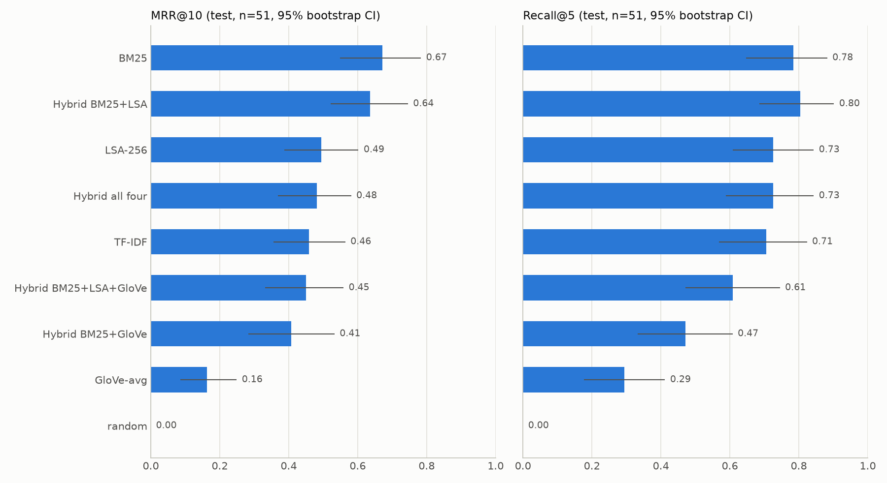

# RAG over the scikit-learn docs: building and *measuring* a retrieval pipeline

A question-answering system over the scikit-learn 1.6.1 user guide (42 files, 128k words) that
retrieves the relevant sections and generates cited answers. The point of the project is the
evaluation: 103 questions with gold sections, a dev/test protocol, bootstrap confidence
intervals, and an honest look at what worked and what did not.



**Headline:** tuned BM25 over section-aware chunks had the best MRR@10 (0.67, 95% CI 0.55 to 0.78) and Recall@5 of 0.78 on 51 held-out questions. A hybrid of BM25 and a small dense embedding model (bge-small-en-v1.5) had the highest Recall@5 (0.88; +0.10 over BM25 in an exploratory paired test, CI 0.02 to 0.18) and nDCG@10 (0.58), but its MRR was not significantly different from BM25's, and it was roughly
200 times slower per query on CPU (314 ms vs 1.3 ms). Dense retrieval alone (MRR 0.59) was also not significantly different from BM25. TF-IDF, LSA, averaged GloVe vectors and three of the other hybrids were significantly worse.LLM generation was run only with a local `llama3.1` (see [Generation](#generation-structural-checks-and-a-small-manual-review)): it refuses off-topic questions reliably, but answer quality is bounded by retrieval.
## What is in the pipeline

| Stage | Implementation |
|---|---|
| Ingest | Parse reStructuredText, strip Sphinx markup, find sections, keep character offsets (`src/ingest.py`) |
| Chunking | Fixed sliding word windows vs structure-aware chunks that never cross a heading and carry their heading path |
| Retrieval | BM25 (written from scratch, sparse-matrix), TF-IDF, LSA, GloVe average, reciprocal rank fusion; optional sentence-transformers retriever and cross-encoder reranker (`src/retrievers.py`) |
| Generation | Grounded prompt with numbered passages, required `[n]` citations, abstention rule; Anthropic, OpenAI-compatible (OpenAI, Ollama, Groq, vLLM...) and an offline extractive mode (`src/rag.py`) |
| Checks | Citation verifier: flags cited passages that do not exist and substantive sentences with no citation |
| Evaluation | Gold-section relevance, Recall@k, MRR, nDCG, bootstrap CIs, paired comparisons (`src/evaluation.py`, `evaluate.py`) |
| Demo | Streamlit app showing the answer, citation check and expandable source passages (`app.py`) |

## How retrieval was evaluated

- **103 questions**, each written about one section of the guide and phrased in natural language (not copying the heading) so keyword matching gets no free ride. Each has a gold section and an `evidence` regex; `eval/validate_eval.py` checks that the regex really appears inside the gold section, which caught 7 labeling problems while building the set (3 evidence phrases that were not in the section, 4 ambiguous section names).
- **Split:** 52 dev / 51 test, disjoint. Everything was chosen on dev; the test split was used only to report (the protocol is in `evaluate.py`).
- **Relevance** is judged on character offsets: a retrieved chunk is a hit if it overlaps the gold section by at least 50% of the smaller of the two. This makes results comparable across chunking strategies.
- **Metrics:** Recall@k (any gold hit in the top k), MRR@10, nDCG@10, with 1,000-sample bootstrap confidence intervals over questions and paired bootstrap differences between systems.
- Two full runs give identical metrics and the same selected configuration (everything is seeded; only latency varies).

## Results

### Test split (n = 51), configuration chosen on dev

| Retriever | Recall@1 | Recall@5 | Recall@10 | MRR@10 | nDCG@10 | ms/query |
|---|---|---|---|---|---|---|
| **BM25** (k1=1.5, b=0.6, stemming) | 0.57 | 0.78 (0.65-0.88) | 0.88 | **0.671** (0.55-0.78) | 0.566 | 1.3 |
| Hybrid BM25 + dense (bge-small-en-v1.5) | 0.51 | **0.88** (0.78-0.96) | 0.88 | 0.657 (0.54-0.76) | **0.579** | 313.6 |
| Hybrid BM25 + LSA | 0.51 | 0.80 (0.69-0.90) | 0.88 | 0.636 (0.52-0.75) | 0.557 | 3.7 |
| Dense (bge-small-en-v1.5) | 0.45 | 0.75 (0.61-0.86) | 0.82 | 0.589 (0.46-0.70) | 0.506 | 214.2 |
| LSA (256 dims) | 0.33 | 0.73 (0.61-0.84) | 0.84 | 0.494 (0.39-0.60) | 0.466 | 2.6 |
| Hybrid all four | 0.33 | 0.73 (0.59-0.84) | 0.86 | 0.482 (0.37-0.58) | 0.448 | 6.0 |
| TF-IDF (1-2 grams) | 0.29 | 0.71 (0.57-0.82) | 0.84 | 0.458 (0.36-0.56) | 0.416 | 1.6 |
| Hybrid BM25 + LSA + GloVe | 0.33 | 0.61 (0.47-0.75) | 0.80 | 0.450 (0.33-0.56) | 0.397 | 3.8 |
| Hybrid BM25 + GloVe | 0.33 | 0.47 (0.33-0.61) | 0.61 | 0.408 (0.28-0.53) | 0.327 | 1.1 |
| GloVe average | 0.08 | 0.29 (0.18-0.41) | 0.33 | 0.163 (0.09-0.25) | 0.144 | 0.2 |
| Random | 0.00 | 0.00 | 0.00 | 0.000 | 0.000 | 0.1 |

Paired MRR@10 difference against BM25 (bootstrap 95% CI): hybrid BM25+dense -0.01 (-0.10 to +0.07), hybrid BM25+LSA -0.03 (-0.11 to +0.03) and dense alone -0.08 (-0.21 to +0.04) are **not significant**. LSA -0.18, hybrid all four -0.19, TF-IDF -0.21, BM25+LSA+GloVe -0.22, BM25+GloVe -0.26 and GloVe -0.51 are all significantly worse (CIs exclude zero). Full table: `results/test_paired_diff_vs_bm25.csv`.

### What I take from it

1. **BM25 is a very strong baseline on technical documentation.** The questions and the docs share identifiers and vocabulary (`warm_start`, `class_weight`, `RidgeCV`). The tokenizer also splits `class_weight` into `class` and `weight`, which lets natural-language questions hit code-style names.
2. **A small dense model did not beat BM25 on its own, but fusing the two raised recall.** Dense MRR was 0.589 vs 0.671 (difference -0.08, CI -0.21 to +0.04), and dense Recall@5 was not significantly different from BM25's (-0.04, CI -0.18 to +0.10). The BM25+dense hybrid reached Recall@5 of 0.88 vs 0.78: +0.10 (paired bootstrap 95% CI 0.02 to 0.18), about five more of the 51 questions. I examined Recall@5 after seeing the results, so treat this as exploratory; on the pre-chosen MRR@10 the hybrid was not significantly different from BM25. The cost is query time: roughly 240x slower per query on CPU.
3. **Fusing in a weak retriever hurts.** Equal-weight rank fusion of BM25 and averaged GloVe dropped MRR from 0.67 to 0.41. Hybrid search is not automatically better than its best member.
4. **Chunking mattered less than I expected, except for very large chunks** (dev, mean MRR over the four base retrievers): section-200 0.456, fixed-100 0.454, section-100 0.451, section-300 0.446, section-200 without heading prefix 0.435, fixed-200 0.416, fixed-300 0.378. The top four are within noise of each other. Prefixing each chunk with its heading path helped the embedding-style retrievers (LSA 0.445 to 0.488, GloVe 0.241 to 0.282) and was neutral for BM25.
5. **Tuning bought little.** Over a 32-point BM25 grid, dev MRR ranged only 0.54 to 0.59; the selected setting (stemming, b=0.6) is 0.589 against 0.548 for the defaults. A difference that size on 52 questions is within noise.
6. **50-question evaluations are noisy.** On dev, BM25 led TF-IDF by 0.04 MRR and LSA trailed TF-IDF; on test BM25 led by 0.21 and LSA beat TF-IDF. The ordering at the top held, the magnitudes did not. Read the confidence intervals, not the third decimal.

### Error analysis

BM25 put its first relevant chunk below rank 3 (or outside the top 10) on 14 of 51 test questions.
Five questions were missed at k=5 by all four base retrievers. Typical causes:

- **Vocabulary mismatch:** "which model mixes two kinds of penalty" (the docs say "L1 and L2-norm regularization"); "discard columns that barely change" (the docs say "low variance").
  Of the 14 questions where BM25 ranked the first relevant chunk below rank 3 or not at all, dense retrieval placed one in its top 3 for 4 (top 5 for 5), and the BM25+dense hybrid for 6 (top 5 for 8).
- **Label noise (strict gold labels):** for "which data structures speed up neighbor lookups" the top hit was the *Ball Tree* section, a defensible answer that the gold label (the *KDTree and BallTree Classes* section) does not credit; similar for the hashing-trick section on a feature-hashing question, and for parent or overview sections on a few others. I did not relabel after seeing test failures, so the numbers above are a **lower bound** on usefulness.
- **Wrong level of section:** the right content sometimes sits in an intro chunk that is judged against a more specific gold subsection.

Per-question results: `results/test_per_question.csv`.

### Generation (structural checks and a small manual review)

`evaluate_generation.py` checks citation structure and abstention without needing a judge model. Run on the 51 test questions plus 10 off-topic ones, with `llama3.1` served locally through Ollama (OpenAI-compatible mode, temperature 0):

| Mode | Cited a gold section (51 test Qs) | Abstains on 10 off-topic Qs | Citation check passed | Wrongly abstained on answerable Qs |
|---|---|---|---|---|
| Extractive baseline (top-2 passages quoted, no LLM) | 71% | 0% | n/a | n/a |
| LLM (`llama3.1`, Ollama), prompt v1 | 73% (37/51) | 100% (10/10) | 61% (31/51) | 4% (2/51) |
| LLM (`llama3.1`, Ollama), prompt v2 (stricter) | 69% (35/51) | 100% (10/10) | 76% (39/51) | 10% (5/51) |

- **Abstention is the clear result.** The LLM refused all 10 off-topic questions, where the extractive baseline answered every one. With only 10 questions, "100%" means "at least roughly 70%".
- **Citing a gold section did not improve** (71% to 73% for v1, within noise at n = 51). It is capped by retrieval: BM25 Recall@5 is 0.78, and the model cannot cite a section it was never shown.
- **Citation failures (v1).** All 20 failures of the citation check were uncited sentences, not invented source numbers.
- **Prompt v2** requires every sentence to end with a citation and to answer only when a passage directly states the answer. On dev: citation check 48% to 73%, wrong abstentions 3 to 6 of 52. Run once on test: citation check 61% to 76%, gold-section citations 73% to 69% (within noise), wrong abstentions 2 to 5 of 51. So v2 buys cleaner citations at the price of refusing a few more answerable questions. v2 was written after I had seen v1's test failures, so the dev numbers are the cleaner evidence, and the 10 off-topic questions were reused for dev and test.
- **Manual correctness review.** I rated a random sample of 20 of the 51 answers (seed 42) against the scikit-learn docs: 15 correct, 1 partly correct, 3 wrong, 1 fair abstention (`results/generation_review.csv`), i.e. 75% fully correct (about 53%-89% as a 95% interval at n = 20). I repeated the review on the same 20 questions with v2's answers and got the same counts (`results/generation_review_v2.csv`). Both reviews were by one person, and I knew the v1 ratings when rating v2, so this is indicative, not a blind comparison, and cannot detect small differences.
- **Failure analysis (v1 sample).** All four answers rated wrong or partly correct had `cited_gold = False`: retrieval never surfaced the gold section. The partly correct one (q060) was an abstention on a question the docs do answer ("barely change" vs the docs' "low variance"). The three wrong answers were confident answers built on off-target passages: a faithful summary of the wrong section (q002, NaN handling), a plausible wrong guess (q050, "LDA" where the KL-divergence factorization is NMF), and an inference from silence (q026, claiming SVMs need no rescaling because the passages never mention it). So the main generation weakness is not abstaining when passages are topically close but do not contain the answer. The two wrong abstentions on the test split (q060, q076) are likely the same kind of retrieval miss. Better retrieval (the dense hybrid above, or the not-yet-run reranker) should help more than prompt changes.
- **Caveats.** Single run, one small local model. All 103 prompts fit within Ollama's default 4096-token context (longest: 1,159 words, about 2,200 tokens by estimate), so truncation did not affect the results.

## What I did not run

- **Cross-encoder reranking** is implemented (`CrossEncoderReranker`) and unit-tested with a stub scorer, but I did not evaluate it.
- **Dense model tuning.** One dense model (bge-small-en-v1.5) was run with default settings and no tuning on dev. Other models might behave differently.
- Single corpus (one library's docs), one question-writer, ~50 test questions.
- **LLM answer correctness** was spot-checked on 20 answers by one reviewer (above), not evaluated at scale or with a judge model. Generation was run only with a local `llama3.1` via Ollama's OpenAI-compatible endpoint; the Anthropic generator and hosted APIs were not run against the live services.

## Run it

```bash
pip install -r requirements.txt
python fetch_corpus.py              # scikit-learn 1.6.1 user guide + GloVe vectors (134 MB)
python eval/validate_eval.py        # checks every gold label against the corpus
python evaluate.py                  # full dev/test protocol, about 1 minute
python evaluate.py --dense BAAI/bge-small-en-v1.5   # optional: adds dense rows (pip install sentence-transformers)
python -m pytest -q                 # 23 tests
python ask.py "How do I add more trees to an already trained forest?"
streamlit run app.py
```

Re-running on a different machine reproduced every row except Hybrid BM25+LSA, which differed in the second decimal (MRR 0.627 vs 0.636), probably from numerical differences in the SVD between library versions. The tables above are from the rerun.

For written answers instead of quoted passages, set a key before `ask.py` or the app:

```bash
export ANTHROPIC_API_KEY=...                       # optionally RAG_MODEL=<model name>
# or any OpenAI-compatible server, including a local one:
export OPENAI_BASE_URL=http://localhost:11434/v1 RAG_MODEL=llama3.1
# unset ANTHROPIC_API_KEY if set; it takes priority
```
To evaluate generation (needs one of the LLM setups above):

```
RAG_PROMPT=v1 python evaluate_generation.py               # prompt v1, test split (the v1 row)
RAG_PROMPT=v1 python evaluate_generation.py --split dev   # tune on dev
RAG_PROMPT=v2 python evaluate_generation.py --split dev   # stricter prompt, dev
RAG_PROMPT=v2 python evaluate_generation.py               # stricter prompt, test split (run once)
```

## Repository layout

```
src/ingest.py         RST cleaning, section parsing, chunkers (offsets preserved)
src/retrievers.py     BM25, TF-IDF, LSA, GloVe, RRF, optional dense + cross-encoder
src/rag.py            prompt, generators, citation verifier, pipeline
src/evaluation.py     relevance judging, metrics, bootstrap
evaluate.py           dev/test protocol; writes results/
evaluate_generation.py structural checks of generated answers (--split dev|test, RAG_PROMPT=v1|v2)
review_answers.py     manual correctness rating of v1 answers (resumable)
review_answers_v2.py  same 20 questions, v2 answers
eval/                 questions.jsonl (103), unanswerable.jsonl (10), builder and validator
results/              every table and figure in this README
tests/                23 tests (cleaning, chunk invariants, metrics, retrievers, mock-server generators)
app.py, ask.py        demo UI and CLI
fetch_corpus.py       downloads the corpus at a pinned release tag (not committed)
```

## Data and licensing

scikit-learn documentation: BSD-3-Clause (https://github.com/scikit-learn/scikit-learn), fetched at tag 1.6.1 and not redistributed here. GloVe 6B vectors (Pennington et al., 2014) are downloaded from the gensim-data release under the Public Domain Dedication and License.
